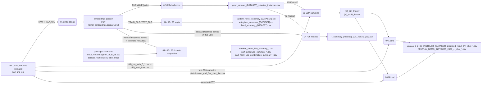

# Pipeline

How the eight stages connect, in which order they can run, and the conventions you need to
know to chain them. Per-stage variables, images and resource flags are in
[stages.md](stages.md).

- [Data flow](#data-flow)
- [Dependencies and parallelism](#dependencies-and-parallelism)
- [Worked example: `hs_01`](#worked-example-hs_01)
- [File-name patterns by stage](#file-name-patterns-by-stage)
- [Collections: canonical and pt](#collections-canonical-and-pt)

## Data flow

`{...}` marks a placeholder (`{DATASET}`, `{id}`, `{N}` = `NUMBER_OF_EXAMPLES`).
Rectangles are files, rounded boxes are stages.



Stage 02 also writes `gmm_random_{DATASET}_value_counts.csv` (label counts per percentage), which
no later stage reads.

## Dependencies and parallelism

| Stage | Must have run first | Can run in parallel with |
|---|---|---|
| 01 | nothing (raw CSVs) | 01 on other files; any stage that already has its inputs |
| 02 | 01 on the dataset's **train** CSV | 02 on other datasets |
| 03 | 02 for the same dataset (plus the raw train CSV, not stage 01 directly) | 03 on other datasets; 04/05/06 |
| 04, 05, 06 single | 01 on the train and test CSVs | each other, and 02/03 |
| 04, 06 method | 01 (train and test) and 02 | each other, 03, and the single variants. 05 has no method variant |
| 04, 05, 06 domain adaptation | 01 on **every** dataset named in the packaged `input_metadata` CSVs. They do not need 02 or 03: the selected indices are in the packaged metadata | each other. 05 and 06 take one `DATASET` per run, so different bases can run in parallel. 04 loops over all bases in one process |
| 07, 08 | 03 for the dataset, the raw test CSV, and the model weights | each other, and 04/05/06 |

Constraints:

- 05, 07 and 08 expect a GPU; give each container its own GPU.
- Outputs are plain files under `WORK_DIR` named by `DATASET` (and method/percentage). Two
  containers writing the same names overwrite each other, so do not start the same stage twice
  for the same dataset against the same directory.
- The domain adaptation indices in the metadata refer to row positions of the embeddings that were
  produced for the research this project is based on. Use embeddings of the same datasets (same row order).
  The same id can denote different datasets in the canonical and the `pt` collections (see
  [Collections](#collections-canonical-and-pt)); `COLLECTION=pt` keeps their files apart by
  working under `WORK_DIR/pt`.

## Worked example: `hs_01`

`hs_01` is a binary dataset. Layout of the host data directory (mounted at `/data`): the raw
CSVs `hs_01_bin_train_0_1.csv` and `hs_01_bin_test_0_1.csv` (`;`-separated, columns `text`,
`label`). Images are assumed built (see [stages.md](stages.md)). Add the resource flags you need.

| Step | Command (all with `docker run --rm -v "$PWD/data:/data" ...`) | Produces in `data/` |
|---|---|---|
| 1 | `-e RAW_FILENAME=hs_01_bin_train_0_1.csv amlb-embeddings`, then the same with `hs_01_bin_test_0_1.csv` | `hs_01_bin_train_0_1_embeddings.parquet.brotli`, `hs_01_bin_test_0_1_embeddings.parquet.brotli` |
| 2 | `-e DATASET=hs_01 -e FILENAME=hs_01_bin_train_0_1_embeddings.parquet.brotli amlb-gmm` | `gmm_random_hs_01_selected_instances.csv` (rows for 25, 50, 75), `gmm_random_hs_01_value_counts.csv` |
| 3 | `-e DATASET=hs_01 -e FILENAME=gmm_random_hs_01_selected_instances.csv amlb-sampling` | `hs_01_bin_llm.csv` (reads `hs_01_bin_train_0_1.csv`) |
| 4a | `-e DATASET=hs_01 -e TRAIN_FILE=hs_01_bin_train_0_1_embeddings.parquet.brotli -e TEST_FILE=hs_01_bin_test_0_1_embeddings.parquet.brotli amlb-rf` (same variables for `amlb-ag`, `amlb-flaml`) | `random_forest_summary_hs_01.csv`, `autogluon_summary_hs_01.csv`, `flaml_summary_hs_01.csv` |
| 4b | `-e DATASET=hs_01 -e FILENAME=gmm_random_hs_01_selected_instances.csv amlb-rf-method` (also `amlb-flaml-method`) | `random_forest_summary_gmm_random_hs_01_{25,50,75}.csv` |
| 5 | `--gpus '"device=0"' -e COLLECTION=pt -e DATASET=hs_01 -e NUMBER_OF_EXAMPLES=5 amlb-llama` (or `amlb-mistral`); weights must already be in `data/` at `MODEL_DIR`; this stage reads the `pt` dataset `hs_01` from `data/pt/` | `LLAMA_3_2_3B_INSTRUCT_hs_01_predicted_result_5_shot_final_remaining.csv` (+ `..._end_index_<i>.csv` every 3000 instances) |

Steps 4a, 4b and 5 are independent of each other once their inputs exist.

Steps 1-4 here run on the canonical `hs_01` (no `COLLECTION`). Step 5 only supports the `pt`
collection, whose `hs_01` is a different dataset. To run the whole example on the `pt` `hs_01`,
put its raw CSVs in `data/pt/` and add `-e COLLECTION=pt` to every command: all files are then
read and written under `data/pt/`. See [Collections](#collections-canonical-and-pt).

Loop over several datasets with plain shell. Stage 01 over a list of raw files:

```sh
# adapt: raw CSV names present in ./data
for f in hs_01_bin_train_0_1.csv hs_01_bin_test_0_1.csv ed_01_multi_train.csv ed_01_multi_test.csv; do
  docker run --rm -v "$PWD/data:/data" -e RAW_FILENAME="$f" amlb-embeddings
done
```

Stage 04 (method variant) over dataset ids whose stage-02 CSVs exist:

```sh
# adapt: dataset ids
for ds in hs_01 ed_01; do
  docker run --rm -v "$PWD/data:/data" \
    -e DATASET="$ds" -e FILENAME="gmm_random_${ds}_selected_instances.csv" amlb-rf-method
done
```

## File-name patterns by stage

The stages were written at different times and do not agree on the order of the tokens
`bin`, `train`/`test` and `0_1`. The table gives the names exactly as the code builds or expects
them.

| Where | Name | Source |
|---|---|---|
| 01 output | `<RAW_FILENAME up to its first '.'>_embeddings.parquet.brotli` | `embedding_generation.py` |
| 02 `train` column | `FILENAME` as given | `gmm_single.py` |
| 02 `test` column | `FILENAME` with every `train` replaced by `test` | `gmm_single.py` |
| 03 raw train input | `<DATASET>_bin_train_0_1.csv` if the `train` column contains `_bin_`, else `<DATASET>_multi_train.csv` | `sampling_datasets_to_llms.py` |
| 03 output | `<DATASET>_bin_llm.csv` / `<DATASET>_multi_llm.csv` | same |
| 07/08 LLM example input | `name_file_llm` of `static/pt/zero_and_few_shot_files.csv`: `<id>_bin_llm.csv` or `<id>_multi_llm.csv` | `zero_and_few_shot_files.csv` |
| 07/08 raw test input | `hs_01_bin_test_0_1.csv`; `fn_01_bin_0_1_test.csv`, `sd_01..sd_06_bin_0_1_test.csv`; `ed_01_multi_test.csv`, `pc_01_multi_test.csv` | same |
| DA embeddings (train and test) | `<id>_bin_{train,test}_0_1_embeddings.parquet.brotli` or `<id>_multi_{train,test}_embeddings.parquet.brotli`, as listed per dataset in `input_metadata/gmm_*.csv` | static metadata |

Inconsistencies to be aware of (not fixed, because renaming would change the published inputs):

- **Binary file names.** Stage 03 requires the raw train file `<id>_bin_train_0_1.csv` for every
  binary dataset, but stages 07/08 look up `fn_01` and `sd_01..sd_06` test files as
  `<id>_bin_0_1_test.csv` (token order `bin_0_1_test`), while `hs_01` is `hs_01_bin_test_0_1.csv`.
  If your raw files follow only one pattern, add copies or symlinks for the other. Stage 01 derives
  the embeddings name from whichever raw name you pass it.
- **Test name derived by substitution.** Stage 02 builds the `test` column by replacing `train`
  with `test` in the train embeddings name. The test embeddings must therefore follow that
  naming, otherwise stages 04/06 method cannot find them.
- **Same id, different variant.** The DA metadata names `fn_01_multi_*`, `pc_01_bin_*`,
  `sd_01_bin_*`, `sd_02..04_multi_*`, whereas 07/08 use `fn_01` and `sd_01..06` as binary and
  `pc_01` as multiclass. These are different collections: the canonical one (default) and `pt`
  (`COLLECTION=pt`, files under `WORK_DIR/pt`).
- The example commands in the Dockerfile headers of 04/05/06 use `hs_01_bin_0_1_train_...`, a
  third spelling. Use the names above (they match the packaged metadata).

## Collections: canonical and pt

The datasets form two **collections**. The **canonical** collection (the `domain_adaptation`
datasets) is the default. The Portuguese datasets (`pt`) are an **adjacent** collection that you
select explicitly with `COLLECTION=pt`. Ids and data file names are the same in both, so an id
is only meaningful together with its collection.

| Collection | `COLLECTION` | Label maps (`src/automl_and_llm_benchmark/static/`) | Datasets | Files under | Used by |
|---|---|---|---|---|---|
| canonical | unset or empty | `label_maps.json` | 49: `ed_01..05`, `fn_01..10`, `hs_01..15`, `pc_01..09`, `sd_01..04`, `ua_01..06` | `WORK_DIR` | 01-06; domain adaptation of 04, 05, 06 (canonical only) |
| `pt` | `pt` | `pt/label_maps.json` | 10: `ed_01`, `fn_01`, `hs_01`, `pc_01`, `sd_01..sd_06` | `WORK_DIR/pt` | 01-06 single/method; 07, 08 (`pt` only) |

Any other `COLLECTION` value is an error. `COLLECTION` is read only by `automl_and_llm_benchmark.common`:

- It moves the I/O root (`paths.work_dir()`, hence every `resolve`, `output_path` and the stage-01
  `READ_DIR`/`WRITE_DIR` defaults) to `WORK_DIR/pt`. Canonical runs keep using `WORK_DIR`.
  `paths.base_work_dir()` is the unmoved `WORK_DIR`. `MODEL_DIR` is not under `WORK_DIR/pt`
  (07/08 read it from the environment as an absolute path), so model weights are shared.
- The two collections reuse `ed_01`, `fn_01`, `hs_01`, `pc_01` and `sd_01..sd_04` with
  **different meanings** (for example `pc_01` is 0-5 quality levels in `pt` and
  negative/positive in canonical; `sd_01` is against/for in `pt` and
  not_hyperpartisan/hyperpartisan in canonical). In particular, stage 01 on the `pt`
  `ed_01_multi_test.csv` writes the same `ed_01_multi_test_embeddings.parquet.brotli` that the
  canonical metadata expects; with `COLLECTION=pt` it is written under `WORK_DIR/pt` instead.
- Labels are loaded with `load_label_map(dataset, collection=None)`; `None`/`""` is canonical.
- The domain adaptation stages (04, 05, 06) call `require_canonical` and stop if `COLLECTION` is
  set. 07 and 08 require `COLLECTION=pt` (there is no canonical LLM file list yet) and stop
  before loading the model otherwise. The single and method variants of 04/05/06 and stages
  01-03 use no label map and work with both.

**Adding a dataset.** Edit the JSON of the collection you need. Each entry is
`"<id>": [[key, value], ...]`, an ordered list of pairs rather than a JSON object, because the
label keys mix `int` and `str` values (`0` and `'0'`), and JSON object keys are always
strings, which would merge them. Then:

- 07/08 (`pt`): also add a row to `static/pt/zero_and_few_shot_files.csv` (`name_dataset;name_file_llm;name_file_predict`),
  and, for a new two-letter task prefix, the task and label-definition dictionaries inside the script.
- Domain adaptation (canonical): also add the dataset to `dataset_relations.csv` and its rows (25/50/75) to
  `input_metadata/gmm_*.csv`.
- A new adjacent collection: add its name to `ADJACENT_COLLECTIONS` in `common/collection.py`
  and its static files under `static/<name>/` (with an `__init__.py`).
- The static data is packaged: reinstall the package (`uv sync` locally) or rebuild the images.
